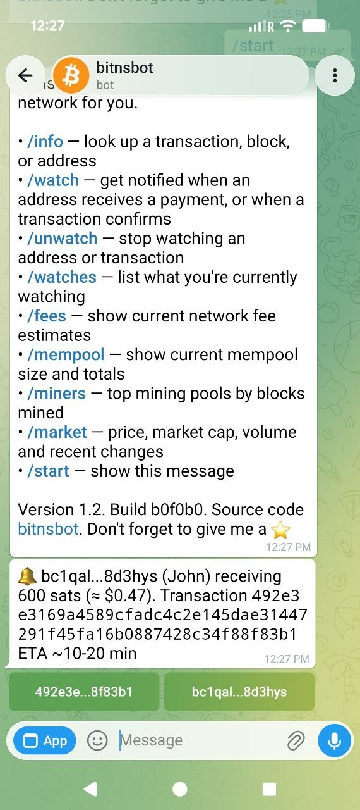
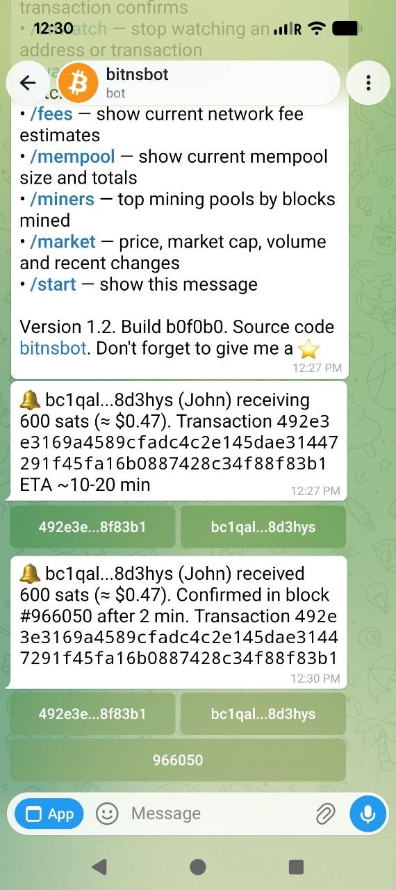
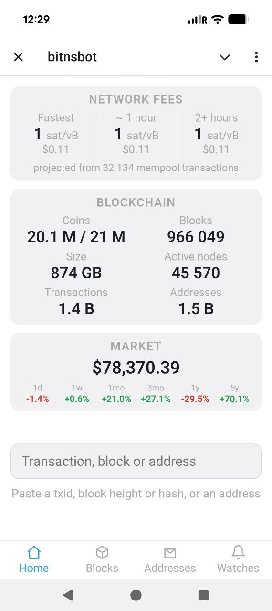
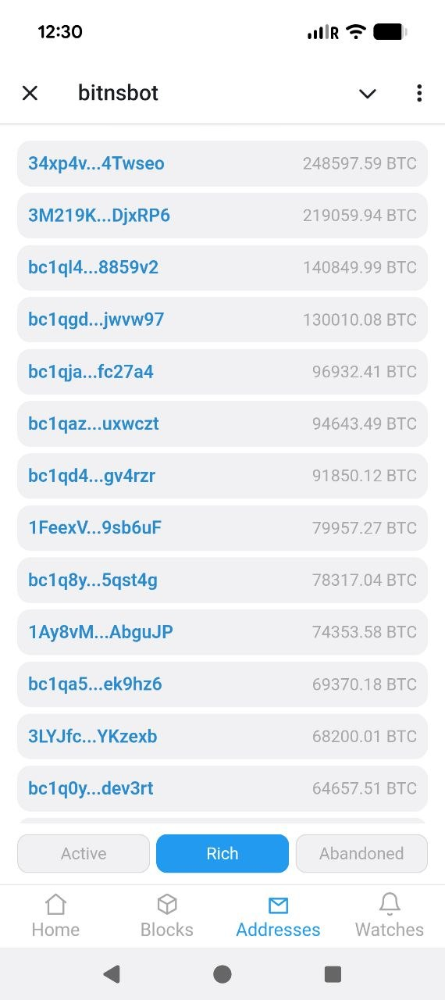
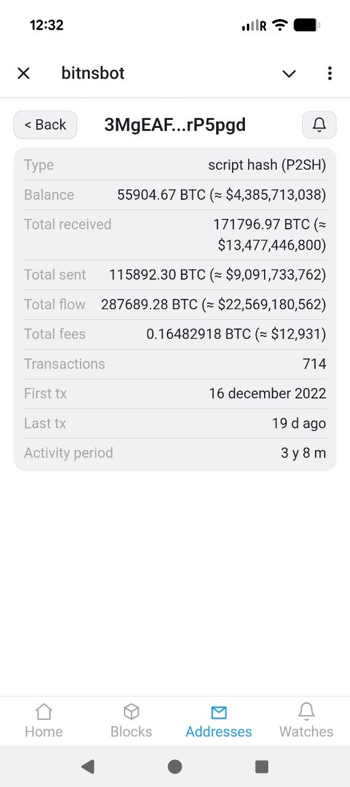

# bitnsbot ([bitnsbot.com](https://bitnsbot.com))
[](https://github.com/pin2t/bitnsbot/actions/workflows/ci.yml)

[@bitnsbot](https://telegram.me/bitnsbot)

Bitcoin blockchain explorer and events notification bot. It can send notifications on watched addresses and transactions. It also sends various information and statistics on Bitcoin network



#### Mini App



### How to run

#### Prerequisites

- Bitcoin Core 31+ node running with RPC, ZMQ notification and transactions index enabled. Fully synced and **not** pruned
- [telegram-bot-api](https://github.com/tdlib/telegram-bot-api) running locally on the same machine

#### Command-line flags

| Flag | Default | Description |
|---|---|---|
| `-config` | | Path to the TOML configuration file |
| `-verbose` | `0` | Log verbosity: `0` = ERR/WARN/status, `1` = +INFO,<br>`2` = +NET/DB |

#### Configuration file

Every other setting lives in a TOML file. A key left out keeps its default; an unknown key stops the bot from starting.

| Section | Key | Default | Description |
|---|---|---|---|
| `[core]` | `url` | | Bitcoin Core JSON-RPC URL, e.g. `http://127.0.0.1:8332`<br>(leave empty to skip connecting to the node) |
| | `user`, `password` | | Bitcoin Core RPC credentials (or use `cookie`) |
| | `cookie` | | Path to Bitcoin Core's `.cookie` file |
| | `zmq` | | ZMQ endpoints publishing `hashblock`, `rawtx` and `sequence` |
| `[telegram]` | `token` | | Telegram bot token (it or `max.token` is required) |
| | `listen` | `:8082` | Address the webhook server listens on |
| | `webhookURL` | | URL the Bot API server should send updates to;<br>its path is the one the webhook server accepts them on |
| | `api` | `http://localhost:8081` | Base URL of the local `telegram-bot-api` server |
| | `secret` | | Optional secret checked against the<br>`X-Telegram-Bot-Api-Secret-Token` header |
| | `registerWebhook` | `true` | Call `setWebhook` on startup |
| `[telegram.app]` | `listen` | `127.0.0.1:8080` | Telegram Mini App address (empty disables it) |
| `[max]` | `token` | | MAX bot token |
| | `listen` | `:8084` | Address the MAX webhook server listens on |
| | `webhookURL` | | Public URL MAX sends updates to |
| | `secret` | | Optional secret checked on every MAX update |
| `[max.app]` | `listen` | `127.0.0.1:8085` | MAX Mini App address (empty disables it) |
| `[db]` | `path` | `bitnsbot.db` | Path to the database |
| `[db.backup]` | `path` | | Path to copy the database to periodically<br>(empty disables backups) |
| | `interval` | `24h` | How old the backup may get |
| | `script` | | Command run after each backup,<br>with the backup path as `$1` and in `$BACKUP_FILE` |

Example `bitnsbot.toml`:

```toml
[core]
url = "http://127.0.0.1:8332"
cookie = "/path/to/.cookie"
# user = "rpcuser"
# password = "rpcpassword"
zmq = ["tcp://127.0.0.1:28332", "tcp://127.0.0.1:28333"]

[telegram]
token = "123456:ABC-DEF1234ghijklmnop"
webhookURL = "http://127.0.0.1:8082/bot"
listen = "127.0.0.1:8082"

[telegram.app]
listen = "127.0.0.1:8080"

[db]
path = "bitnsbot.db"

[db.backup]
path = "/var/backups/bitnsbot.db"
interval = "24h"
```

#### Running

Build and run:

```bash
go test ./... && go build .
```

```bash
./bitnsbot -config=bitnsbot.toml -verbose=1
```

Another option: there are [scripts](scripts) to deploy a bot as a systemd service.

### Useful tools

[advertise](tools/advertise) - simple command line tool which sends advertising packets with a specific IP to all nodes in Bitcoin network

[bboltwui](https://github.com/pin2t/bboltwui) - simple web interface to manage a bbolt database, in a repository of its own
                   
i18n-vet - check translation 

addrindex - build transaction history index on addresses. Gather other statistics

### Roadmap

- [x] I18N
- [x] Mini App
- [x] Addresses statistics
- [ ] Daily statistics. Send every day market, transactions volume, moved coins, etc statistics
- [ ] Improve data quality. More reliable and correct answers on addresses
